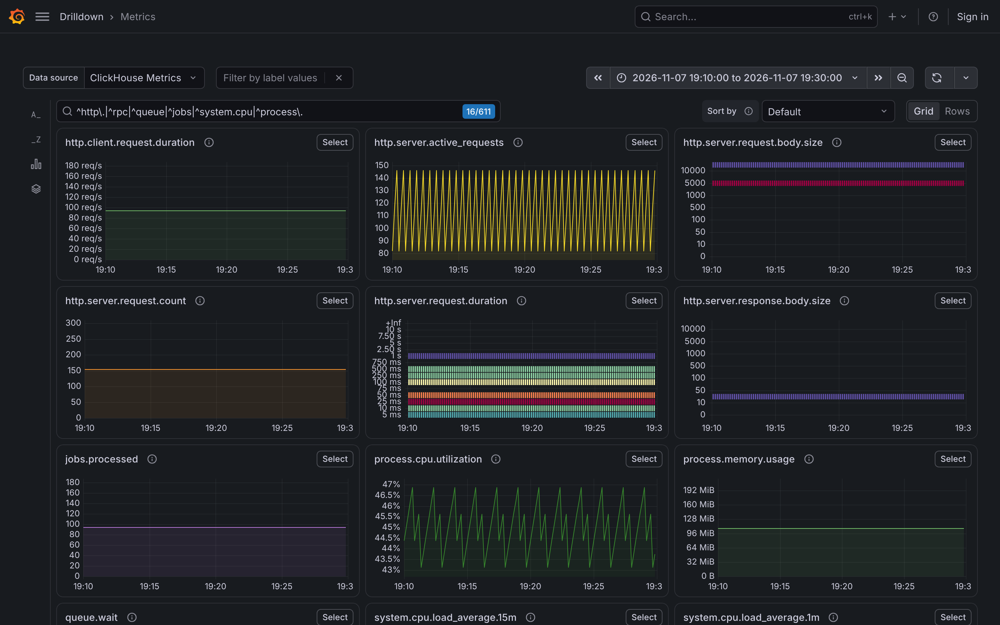
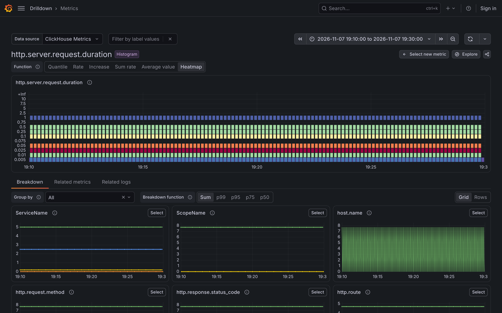
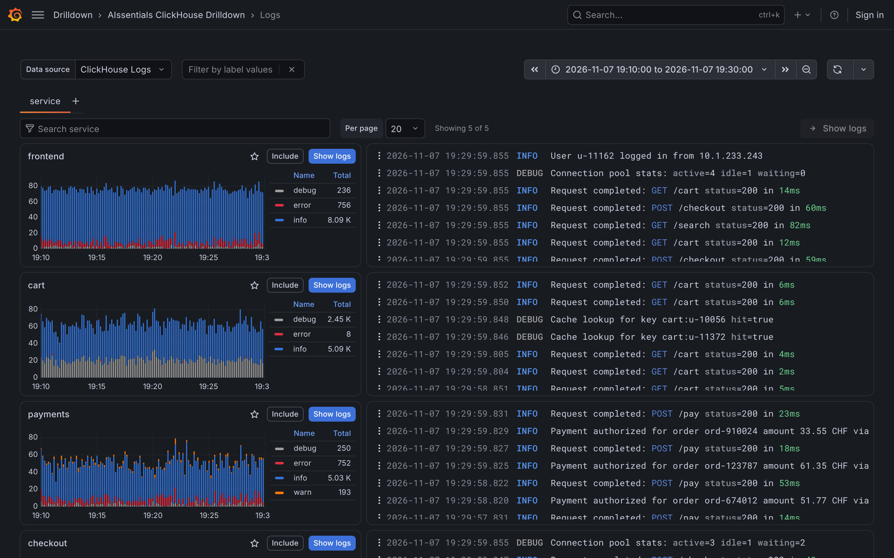
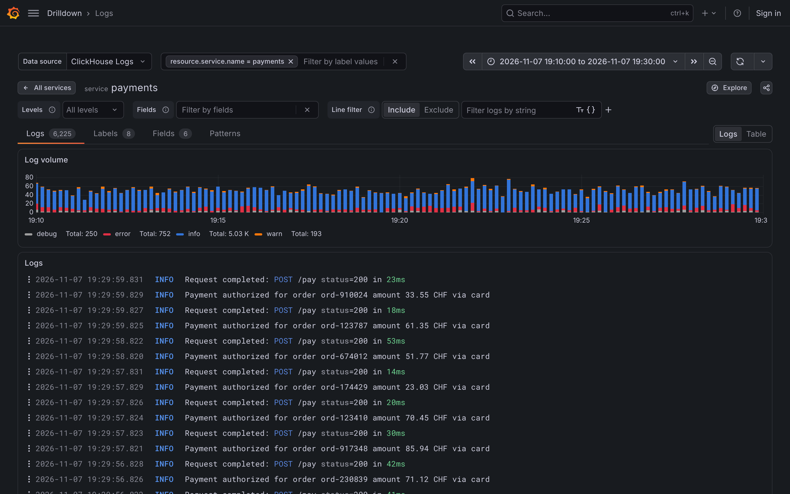
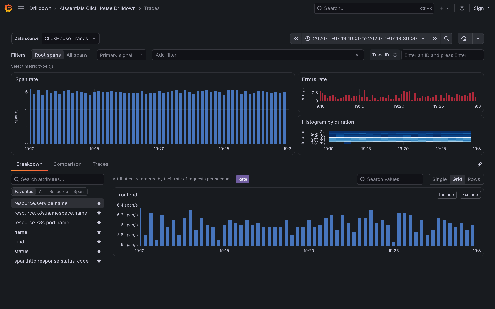
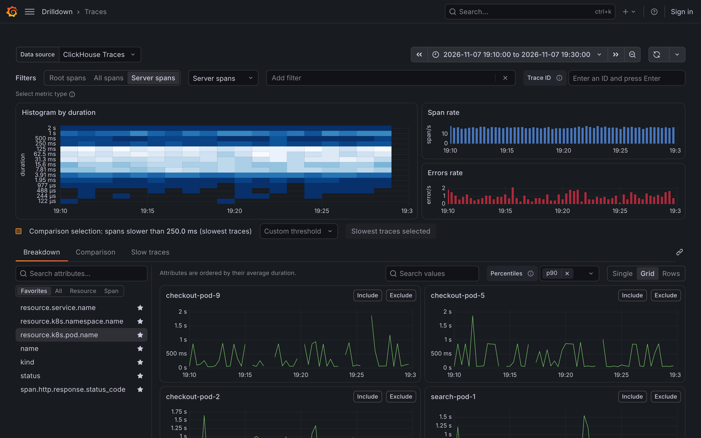

# AIssentials ClickHouse Drilldown

[](https://github.com/OneCyrus/aissentials-clickhouse-drilldown-app/actions/workflows/ci.yml)
[](https://github.com/OneCyrus/aissentials-clickhouse-drilldown-app/releases/latest)
[](https://grafana.com/)
[](LICENSE)

**Explore OpenTelemetry metrics, logs and traces in ClickHouse without writing a single query.**

AIssentials ClickHouse Drilldown is a Grafana app plugin that brings the experience of Grafana's Metrics, Logs and Traces Drilldown apps to OpenTelemetry data stored in ClickHouse. Point it at the tables of the [OpenTelemetry Collector ClickHouse exporter](https://github.com/open-telemetry/opentelemetry-collector-contrib/tree/main/exporter/clickhouseexporter), pick a metric, a service or a span set, and narrow it down by clicking: every chart, breakdown and filter is generated SQL that runs through the official ClickHouse data source.



## Features

### Metrics

- A grid of every metric, with a sidebar to filter by prefix, suffix, metric type and label, regex search and sorting.
- One click to a metric with the right function for its type: rate and increase for counters, quantiles and heatmaps for histograms, sum, avg, min or max aggregation.
- Breakdown by any label, with "outlying series" sorting to find the series that behave differently.
- Related metrics by name similarity and related logs of the same services.



### Logs

- All services (or any other resource attribute) with log volume by level and their latest lines.
- A service with level, field and line filters, and the **Logs**, **Labels**, **Fields** and **Patterns** tabs.
- Log patterns computed in ClickHouse: numbers, IDs, IP addresses and quoted values become `<_>`.
- A log list and a table view, with links to Explore.





### Traces

- Rate, errors and duration (RED) of a span set: root spans, all spans, server spans, consumer spans and more.
- **Breakdown** by any resource or span attribute, with favorite attributes in a sidebar.
- **Comparison** of a selection, such as the slowest spans or the erroneous spans, with its baseline, to find the attributes that make the difference.
- **Exceptions**, the list of matching traces and a trace view.





### Everywhere in Grafana

Panels on dashboards and Explore queries of the ClickHouse data source get an **Open in AIssentials ClickHouse Drilldown** entry, in the panel menu and the Explore toolbar. It opens the matching app with the same time range; a metrics query opens its metric.

## Requirements

- Grafana **11.6.11 or later**, the same lower bound as Grafana's own Drilldown apps. Tested with Grafana 13.3.
- The [ClickHouse data source](https://grafana.com/grafana/plugins/grafana-clickhouse-datasource/) connected to your OpenTelemetry data.
- Tables in the layout of the OpenTelemetry Collector ClickHouse exporter: `otel_metrics_*`, `otel_logs` and `otel_traces`, with Map attributes.

## Installation

Download the latest archive from the [releases page](https://github.com/OneCyrus/aissentials-clickhouse-drilldown-app/releases/latest) and install it with the Grafana CLI:

```bash
grafana cli \
  --pluginUrl https://github.com/OneCyrus/aissentials-clickhouse-drilldown-app/releases/download/v0.1.0/aissentials-clickhousedrilldown-app-0.1.0.zip \
  plugins install aissentials-clickhousedrilldown-app
```

or, with the Grafana Docker image (Grafana 12 or later):

```bash
docker run -p 3000:3000 \
  -e GF_PLUGINS_PREINSTALL_SYNC="grafana-clickhouse-datasource,aissentials-clickhousedrilldown-app@0.1.0@https://github.com/OneCyrus/aissentials-clickhouse-drilldown-app/releases/download/v0.1.0/aissentials-clickhousedrilldown-app-0.1.0.zip" \
  -e GF_PLUGINS_ALLOW_LOADING_UNSIGNED_PLUGINS=aissentials-clickhousedrilldown-app \
  grafana/grafana
```

You can also unzip the archive into Grafana's plugin directory and restart Grafana.

Until the plugin is signed, allow it in `grafana.ini`:

```ini
[plugins]
allow_loading_unsigned_plugins = aissentials-clickhousedrilldown-app
```

The app is enabled after installation and appears under **Apps**. To list it in Grafana's **Drilldown** menu section next to Grafana's own apps:

```ini
[navigation.app_sections]
aissentials-clickhousedrilldown-app = drilldown
```

### Versions

| Channel  | Where                                                                                                                                               | Version            |
| -------- | --------------------------------------------------------------------------------------------------------------------------------------------------- | ------------------ |
| Official | [Releases](https://github.com/OneCyrus/aissentials-clickhouse-drilldown-app/releases/latest), one per tag                                           | `1.2.3`            |
| Preview  | The [preview](https://github.com/OneCyrus/aissentials-clickhouse-drilldown-app/releases/tag/preview) pre-release, rebuilt on every commit to `main` | `1.2.4-preview.42` |

Preview builds are for trying out changes before a release; they are never signed.

## Configuration

The app reads the database and table names from the ClickHouse data source settings:

- **Logs and traces** use the data source's logs and traces defaults. Use one data source with both defaults set, or a data source per signal.
- **Metrics** work with any ClickHouse data source. With a data source version that supports OTel metrics, the metric tables are configurable and **Explore** opens metrics in its metrics query editor. Otherwise the exporter's default tables in the configured database (or `otel`) are used.

Each app has a data source picker; the choice is kept in the URL, so links can be shared.

## How it works

- Each app is a [Grafana Scenes](https://grafana.com/developers/scenes) app. Queries are raw SQL queries of the ClickHouse data source, so its connection, permissions, macros (`$__timeFilter`, `$__timeInterval`, `$__interval_s`) and result formats apply.
- Filters are built from attribute keys such as `resource.k8s.pod.name`, `span.http.route` or `log.user.id` and turn into SQL conditions on the Map columns.
- Metrics queries come from `src/clickhouse/metrics.ts`, derived from the ClickHouse data source's OTel metrics support: rates with counter resets and both temporalities, histogram quantiles and heatmaps, so they match its query editor.

### Differences from Grafana's Drilldown apps

- The duration comparison selection defaults to the slowest quarter of the duration buckets, with a threshold list instead of dragging on the heatmap.
- "Outlying series" sorting ranks by distance from the mean series instead of a WebAssembly outlier detector.
- Not included: the Structure tabs of Traces Drilldown, bookmarks, saved searches, the JSON log view, Add to dashboard and Create alert, the time seeker and exemplars.
- Filter keys and URLs use OTel attribute names (`resource.service.name`) instead of Prometheus and Loki label names.

## Development

```bash
npm install
npm run dev          # build in watch mode into dist/
npm run build        # production build
npm run typecheck
npm run lint
npm run test:ci
```

`docker compose up` starts Grafana 13.3 with the ClickHouse data source installed and `dist/` mounted as the app; add a ClickHouse data source for your OpenTelemetry data there.

The build is the standard [create-plugin](https://grafana.com/developers/plugin-tools/) setup (`.config/`), extended in `webpack.config.ts` for the Scenes library: `react-router-dom` maps to Grafana's `react-router` module and `react/jsx-runtime` comes from Grafana.

### Continuous integration and releases

- **CI** (`.github/workflows/ci.yml`) runs type checks, lint, formatting, spelling, tests and the build on every pull request and every push to `main`.
- **Preview builds:** every push to `main` publishes the archive as a workflow artifact and replaces the `preview` pre-release. The version is the next patch after the latest release with `-preview.<run number>`.
- **Releases** (`.github/workflows/release.yml`): pushing a tag `vX.Y.Z` builds that version, signs it when the `GRAFANA_ACCESS_POLICY_TOKEN` secret is set, attests the build provenance (public repositories) and creates a GitHub release with the archive, its SHA-1 and SHA-256 checksums and the version's section of `CHANGELOG.md` as notes.

To release a version:

```bash
# 1. Add a "## 1.2.3" section to CHANGELOG.md and commit it to main.
# 2. Tag and push:
git tag v1.2.3
git push origin v1.2.3
```

The version comes from the tag; `package.json` does not need to change. Instead of pushing a tag, you can also run the **Release** workflow from the Actions tab with the version: it creates the tag on the latest commit of `main`.

## License

Apache License 2.0. `src/clickhouse/` is derived from [grafana/clickhouse-datasource](https://github.com/grafana/clickhouse-datasource) (Apache License 2.0).
